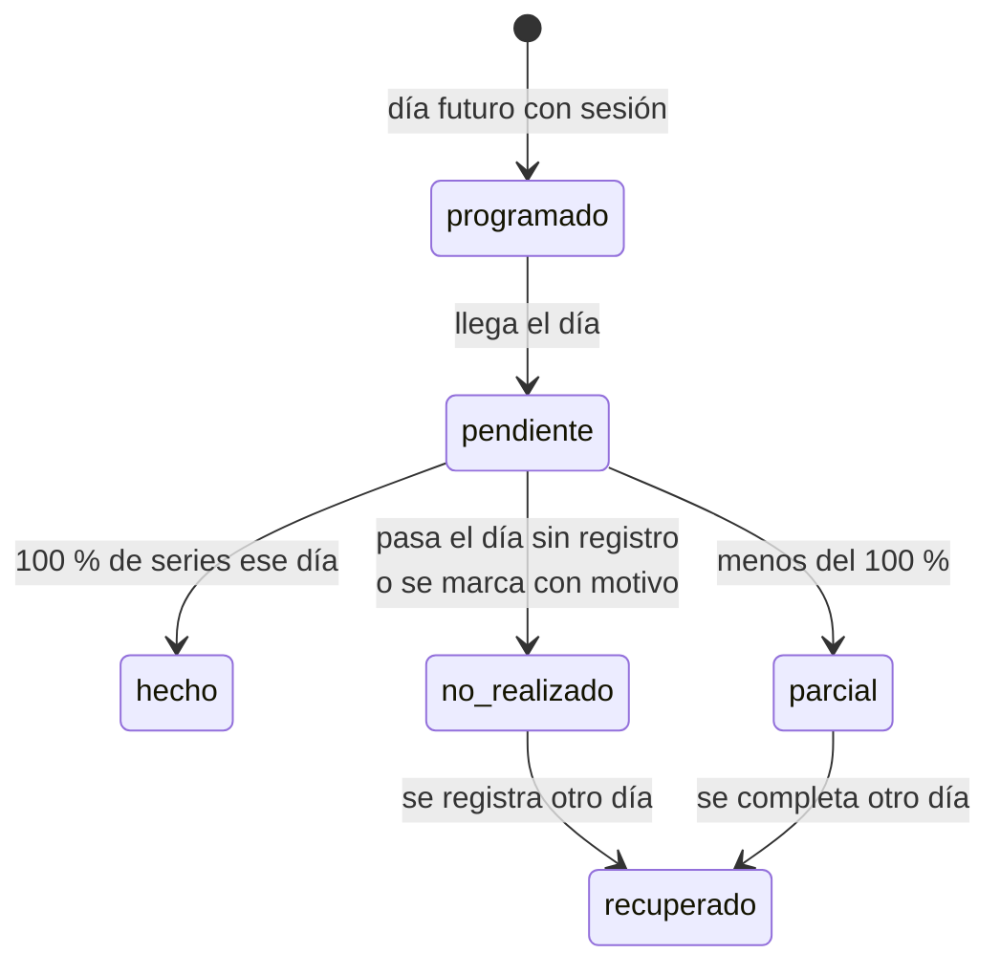
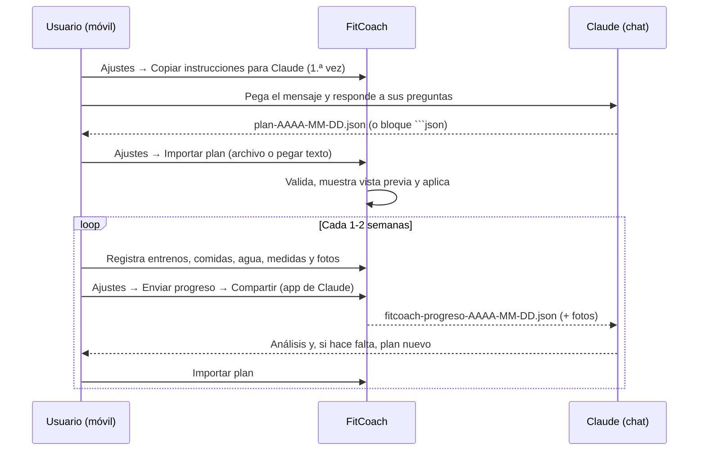

# FitCoach

PWA (app web instalable) para Android que sirve para seguir un objetivo de composición corporal: rutina de gimnasio, dieta, agua, peso, perímetros y fotos. Claude hace de entrenador mediante archivos de export (progreso → Claude) e import (plan nuevo de Claude → app).

- Funciona **sin conexión** y **sin servidor**: todos los datos viven en el móvil (IndexedDB).
- **Sin dependencias** ni paso de compilación: HTML, CSS y JavaScript (módulos ES) tal cual.
- Interfaz en español, unidades métricas, semanas de lunes a domingo, tema claro/oscuro.

---

## 1. Qué hace

| Pantalla | Contenido |
|---|---|
| **Inicio** | Entreno de hoy, avisos (entrenos por recuperar, nota del entrenador, fin de rutina, export pendiente), hitos de hoy, agua con botones rápidos, dieta del día, semana actual, resumen de progreso y próximos hitos. |
| **Entreno** | Semana actual con estados, entrenos por recuperar, sesiones de la rutina y historial. |
| **Sesión** (`#/sesion`) | Registro serie a serie (reps × kg), última marca de cada ejercicio, temporizador de descanso con vibración y sonido, superseries, pantalla siempre encendida, borrador que sobrevive a cerrar la app, récords personales. Permite registrar un entreno en otro día (recuperar) o hacer uno extra. |
| **Calendario** | Mes con entrenos en verde (hecho), ámbar (parcial), rojo (no realizado), ↻ (recuperado otro día) e hitos (fotos, pesaje, perímetros, inicio/fin, revisión). Al tocar un día: detalle, registrar, marcar como no realizado con motivo, añadir o borrar hitos. |
| **Dieta** | Menú del día (hoy por defecto, navegable a días pasados y futuros), macros, comidas marcables, agua y notas del día. |
| **Compra** | Lista semanal sumada a partir de la dieta, agrupada por categoría, con casillas, productos extra y opción de compartir. |
| **Progreso** | Peso (con media de 7 días y objetivo), % de grasa, perímetros, fotos con comparador antes/después y fuerza (1RM estimado por ejercicio). |
| **Ajustes y Claude** | Exportar progreso, importar plan (archivo o texto pegado), instrucciones para el primer chat, gestión de planes, perfil, preferencias, copia de seguridad y restauración. |

### Estados de un entreno programado



---

## 2. Flujo con Claude



- **Export** (`fitcoach-progreso-*.json`): perfil, plan vigente (definición completa), resumen ya calculado (cumplimiento, racha, tendencia de peso en kg/semana, perímetros), cada día programado con su estado y las series reales frente al objetivo, dieta (comidas hechas/no hechas), agua, todas las mediciones, comentarios del usuario y próximos hitos. **Incluye las instrucciones del formato de import**, así que Claude siempre sabe cómo responder. Con fotos: "Compartir" envía el JSON y las imágenes sueltas; "Descargar" genera un ZIP.
- **Import** (`fitcoach-plan`): secciones opcionales `rutina`, `dieta`, `hitos` y `hitosRecurrentes`. Un plan nuevo sustituye al anterior a partir de su `fechaInicio` y el historial se conserva. Si hay errores no se aplica nada y se pueden copiar para pasárselos a Claude.
- La especificación completa del formato está en un solo sitio: [`js/claude-spec.js`](js/claude-spec.js) (`SPEC_TEXT`). El plan de ejemplo del primer arranque (`examplePlan`) sirve también como ejemplo del formato.

---

## 3. Probar en el ordenador

Necesitas Python 3 (ya instalado).

```powershell
python fitcoach/tools/serve.py
```

Abre `http://localhost:8765` y, en las herramientas de desarrollo del navegador (F12), activa la vista de móvil. El servidor desactiva la caché para que veas los cambios al recargar. En `localhost` la caché offline (service worker) está desactivada; para probarla abre `http://localhost:8765/?sw=1`.

### Tests

Con el servidor arrancado, abre `http://localhost:8765/tests/`. Son 19 tests de la lógica sin interfaz (no tocan tus datos):

- Fechas: cambios de mes y de hora, semana de lunes a domingo, validación, días con tilde.
- Extracción de JSON desde texto de chat (con y sin bloque ```json).
- Validación de planes: plan de ejemplo válido, errores típicos, rechazo de un export, sesiones referidas por nombre, la palabra "descanso" (día libre en la rutina frente a tipo de día en la dieta) y dieta sin `semana`.
- Resolución de plan por fecha (sustitución, `fechaFin`) y ciclos de varias semanas.
- Estados de entreno (hecho, recuperado, parcial, no realizado, pendiente, programado).
- Hitos recurrentes.
- ZIP: CRC32 de referencia, ida y vuelta con UTF-8 y datos binarios.
- Suma de la lista de la compra.
- Escapado de HTML importado (protección frente a XSS).

---

## 4. Instalar en el móvil Android

Para instalarse como app, la PWA tiene que servirse por **HTTPS**. Opciones gratuitas:

**A. Netlify Drop (lo más sencillo, sin git)**
1. Entra en <https://app.netlify.com/drop> e inicia sesión.
2. Arrastra la carpeta `fitcoach` entera. Te dará una URL `https://algo.netlify.app`.
3. Para actualizar la app, vuelve a arrastrar la carpeta en el mismo sitio ("Deploys" → arrastrar).

**B. GitHub Pages**
1. Crea un repositorio (puede ser privado con GitHub Pro; si no, público: los datos **no** se suben, solo el código).
2. Sube el contenido de `fitcoach/` a la raíz del repositorio.
3. Ve a *Settings → Pages → Deploy from a branch → main / root*. La URL será `https://<usuario>.github.io/<repo>/`.

**En el móvil:** abre la URL en **Chrome** → menú ⋮ → **Instalar aplicación** (o "Añadir a pantalla de inicio"). A partir de ahí se abre a pantalla completa y funciona sin conexión.

> Importante: los datos están en el navegador de ese móvil. Si borras los datos de Chrome o desinstalas la app, se pierden. Haz **Ajustes → Copia** de vez en cuando y guárdala, por ejemplo, en Google Drive.

---

## 5. Guía para desarrolladores (y asistentes de código)

### Estructura

```
fitcoach/
├── index.html              Shell + CSP estricta
├── manifest.webmanifest    Metadatos de la PWA (iconos, atajos)
├── sw.js                   Service worker (caché offline, stale-while-revalidate)
├── css/app.css             Estilos y tokens de tema (claro/oscuro)
├── icons/                  Iconos PNG generados por tools/make_icons.py
├── js/
│   ├── app.js              Arranque, rutas por hash (#/inicio…), cabecera, navegación, onboarding
│   ├── db.js               Envoltorio de IndexedDB (stores: kv, plans, workouts, dietLogs, water, measurements, photos)
│   ├── store.js            Estado en memoria + consultas síncronas + mutaciones persistentes
│   ├── plans.js            LÓGICA PURA: validar/normalizar planes, plan por fecha, estados, hitos recurrentes
│   ├── sync.js             Export para Claude, import de planes, compartir/descargar, copia de seguridad
│   ├── claude-spec.js      Contrato con Claude (SPEC_TEXT), plan de ejemplo, mensaje inicial
│   ├── dates.js            Fechas locales 'AAAA-MM-DD'
│   ├── ui.js               html`` con escapado, iconos SVG, toasts, hojas inferiores, confirmaciones
│   ├── widgets.js          Componentes compartidos: agua, detalle de día, medidas, fotos, hitos
│   ├── charts.js           Gráficas SVG
│   ├── zip.js              ZIP sin dependencias (escritura "store"; lectura store/deflate)
│   └── views/              Una vista por pantalla: render(el, ctx) → función de limpieza opcional
├── tests/                  Tests en navegador (index.html + tests.js)
└── tools/                  serve.py (servidor local sin caché), make_icons.py
```

### Convenciones

- **Fechas**: siempre cadenas locales `AAAA-MM-DD` (nunca `toISOString()`, que usa UTC). Usa `dates.js`.
- **HTML**: genera la interfaz con la plantilla `html``…`` de `ui.js`, que escapa todo lo interpolado. Usa `raw()` solo con HTML creado por la app. Los planes importados son datos no confiables.
- **Vistas**: `export default { render(el, ctx) }`. `ctx.header(título, {sub, back, actions})`, `ctx.go('ruta?param=x')` y `ctx.refresh()` (vuelve a pintar manteniendo el scroll; cierra las hojas abiertas).
- **Hojas inferiores**: `openSheet({title, body, onMount(el, close)})`. `close()` devuelve una promesa; espera a que se resuelva antes de navegar o abrir otra hoja (se integra con el botón atrás de Android).
- **Estado**: lee de `S` y de las consultas de `store.js`; escribe solo mediante sus mutaciones (persisten en IndexedDB).
- **Lógica nueva sin interfaz**: ponla en `plans.js` (o en un módulo puro) y añade un test en `tests/tests.js`.

### Tareas habituales

- **Añadir una pantalla**: crea `js/views/x.js`, regístrala en `ROUTES` de `app.js`, añádela a `SHELL` en `sw.js` y sube `CACHE` (`fitcoach-v2`…).
- **Añadir un campo al plan de Claude**: normalízalo en `plans.js`, documéntalo en `SPEC_TEXT` (`claude-spec.js`), úsalo en la vista y añade un test.
- **Añadir datos al export**: amplía `buildProgress()` en `sync.js`.
- **Publicar una versión**: sube `CACHE` en `sw.js` para que los móviles descarguen los archivos nuevos (se aplican en el siguiente arranque).
- **Regenerar iconos**: `python fitcoach/tools/make_icons.py`.

### Seguridad y privacidad

- CSP estricta en `index.html`: solo se cargan scripts propios y no hay conexiones externas.
- Ningún dato sale del móvil salvo cuando el usuario exporta o comparte.
- No hay credenciales, claves de API ni cuentas.
- Los planes importados se validan y todo su texto se escapa al mostrarlo.

### Limitaciones conocidas

- Sin notificaciones push (requieren servidor). Los recordatorios se muestran al abrir la app.
- Los datos son por dispositivo: para cambiar de móvil, usa Copia → Restaurar.
- Chrome puede borrar el almacenamiento si el móvil se queda sin espacio. La app pide almacenamiento persistente, pero conviene hacer copias.
